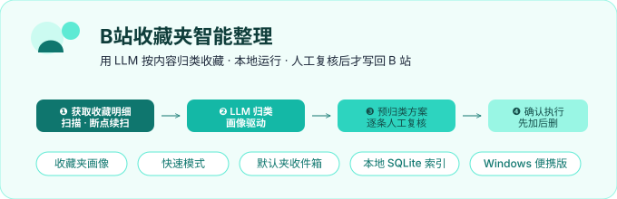
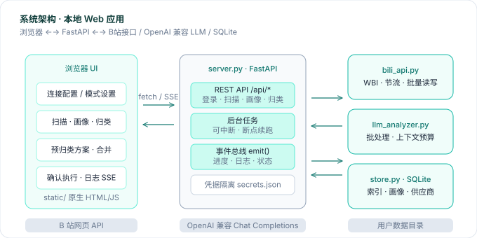
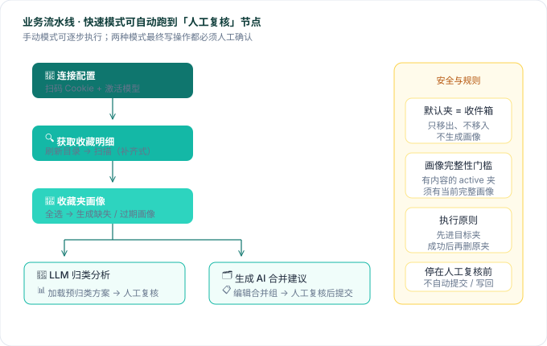
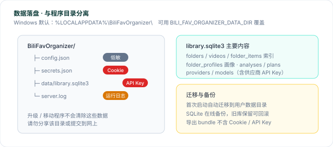

# B站收藏夹智能整理

<p align="center">
  <picture>
    <source media="(prefers-color-scheme: dark)" srcset="static/brand/lockup-horizontal-inverse.svg">
    
  </picture>
</p>

[](https://github.com/Martin-soaring-dev/bili-fav-organizer/releases/latest)
[](https://github.com/Martin-soaring-dev/bili-fav-organizer/releases/latest)
[](#从源码运行开发)
[](#许可)
[](https://github.com/Martin-soaring-dev/bili-fav-organizer/actions/workflows/ci.yml)

<p align="center">
  
</p>

一个本地运行的 Web 工具：用 **LLM** 按**内容**把 B 站收藏夹里的视频自动归类到合适的收藏夹，并提供收藏夹画像与合并整理能力。

**核心原则**：归类方案必须人工复核后才执行；执行时先加入目标夹、成功后再从原夹删除；默认收藏夹是「未分拣收件箱」，只出不进。

**当前稳定版：v0.210.5。** 前往[最新正式版 Release](https://github.com/Martin-soaring-dev/bili-fav-organizer/releases/latest)下载。本版重点修复任务锁定、外部链接、任务恢复与 SQLite 写入可靠性。第一次使用？阅读[图文版快速上手指南](docs/快速上手.md)，或下载 [PDF 版](output/pdf/快速上手.pdf)。指南中的部分截图来自旧版界面，安装与操作方式请以当前版本实际界面为准。

**品牌与视觉设计**：查看[完整设计规范](docs/brand/README.md)、[SVG 设计语言](docs/brand/svg-language.md)和[矢量资产](static/brand/)。

---

## 它能做什么

| 能力 | 说明 |
|------|------|
| 🔍 获取收藏明细 | 扫码登录 / 手动 Cookie，拉取收藏夹与视频元数据，支持断点续扫（收藏夹级：已完成夹不重复读取，未完成夹重新读取） |
| 🧭 收藏夹画像 | 按完整扫描快照生成简介、主题、收纳范围；可预览后上传到 B 站简介 |
| 🤖 LLM 归类分析 | 依据画像批量推断每个视频的归属，并给出偏离提示 |
| 📊 预归类方案 | 可视化统计 + 逐条修改（移入 / 新建 / 跳过） |
| 🚀 确认执行 | B 站批量 `move` / 失效视频批量删除；风控时立即停 |
| 🗂 收藏夹整理 | AI 合并建议 + 可编辑草稿 + 人工复核后提交执行 |
| ⚡ 快速模式 | 自动串起「目录 → 扫描 → 画像 → 分析 / 合并建议」，停在人工复核前 |

---

## 快速开始

### Windows 安装版

1. 打开 [Releases](https://github.com/Martin-soaring-dev/bili-fav-organizer/releases)，下载 `BiliFavOrganizer-Setup-<版本标签>.exe`
2. 运行安装包：向导里会让你**选择安装范围**（仅当前用户免管理员 / 为所有用户需 UAC），并需要勾选接受许可协议
3. 安装完成后从开始菜单（可选桌面快捷方式）启动；卸载在 Windows「应用和功能」里，卸载时会询问是否同时删除个人数据

安装版在应用内更新时改为"下载新安装包并静默运行"，由安装程序完成替换与重启。两种形态的数据目录相同（`%LOCALAPPDATA%\BiliFavOrganizer`），切换安装方式不会丢数据。

### Electron Neo 桌面版（v0.209 起）

1. 打开[最新正式版 Release](https://github.com/Martin-soaring-dev/bili-fav-organizer/releases/latest)，下载 `BiliFavOrganizer-neo-Setup-<语义化版本>.exe`（v0.209 对应 `BiliFavOrganizer-neo-Setup-0.209.0.exe`）。
2. 安装并从开始菜单启动；Electron 负责桌面窗口及后端进程，无需手动打开浏览器或保留控制台。
3. 从传统版本迁移时先备份个人数据；如已启用加密保险库，请妥善保管密码与恢复码。不要使用传统壳的应用内更新器覆盖 Neo。

### Windows 便携版

1. 打开 [Releases](https://github.com/Martin-soaring-dev/bili-fav-organizer/releases)，下载 `BiliFavOrganizer-Windows-x64-<版本标签>.zip`
2. 解压后双击 **`BiliFavOrganizer.exe`**（或 `BiliFavOrganizer.bat`）
3. 浏览器自动打开 **http://127.0.0.1:8080**

便携包已集成 Python 运行环境，无需另装 Python / pip。服务运行期间请保留控制台窗口，关闭窗口即停止。

> 请下载带版本标签的 Release 附件，不要下载 GitHub 自动打包的 `Source code.zip`（那是源码，不含运行环境）。

### 从源码运行（开发）

```bash
pip install -r requirements.txt
python server.py            # 默认 8080，可加 --port 8090
```

Windows 也可双击 **`BiliFavOrganizer.bat`**：首次会检查并安装 Python 3.13 与依赖，然后启动服务。
使用本项目启动入口时，同一用户数据目录一次只运行一个服务进程；切换到其他端口启动前，请先关闭当前服务。Electron 桌面版也会阻止重复启动。

---

## 使用流程

**详细步骤**（手动模式；快速模式会自动跑到「人工复核」前）：

1. **🔌 连接配置**
   - Cookie：默认二维码登录，可切换手动输入；保存后点「测试 Cookie」
   - 模型：点「管理模型」添加供应商 / 填 API Key，保存并「激活」
   - [AMD Radeon Cloud Token Factory](https://developer.amd.com.cn/radeon/tokenfactory) 可用预设 + 平台 API Key

2. **⚡ 模式设置**
   - **快速模式**：选「内容整理」或「收藏夹整理」→ 点「开始自动整理」
   - **手动模式**：按下方各栏逐步自行操作

3. **🔍 获取收藏明细** → 「刷新收藏夹目录」→ 选扫描范围 → 「开始扫描」
   - 扫描方式默认「继续未完成/变化的夹」（补齐式）
   - 请求间隔默认 **2 秒**（固定间隔，无随机抖动）

4. **🧭 收藏夹画像** → 「全选 active」→ 「生成缺失 / 过期画像」
   - 默认收藏夹（未分拣收件箱）不生成画像，也不是移入目标
   - 画像是归类与合并的主要依据，收藏夹名称只是弱提示

5. **🤖 LLM 归类分析** → 设批大小 / 并发 → 「开始分析」
   - 开始前要求所有**有内容**的 active 夹都有当前完整画像
   - 发送前按上下文预算自动拆批；截断结果不采纳

6. **📊 预归类方案** → 「加载分析结果」→「查看详情」逐条确认

7. **🚀 确认执行** → 确认方案 → 设写操作间隔 → 「开始执行」
   - 明确失败会记录后继续；风控或结果不确定（`unknown`）时停止，需人工复核

---

## 系统架构

<p align="center">
  
</p>

| 模块 | 职责 |
|------|------|
| `server.py` | FastAPI 主程序：REST API、后台任务、SSE 事件 |
| `bili_api.py` | B 站网页接口封装：会话、节流、批量读写 |
| `llm_analyzer.py` | 归类 / 画像 / 合并建议；上下文预算与 TPM 限流 |
| `store.py` | SQLite：目录、视频索引、画像、方案、供应商模型 |
| `static/` | 原生 HTML / CSS / JS 单页 UI |

---

## 业务流水线与安全规则

<p align="center">
  
</p>

| 规则 | 说明 |
|------|------|
| 默认夹 = 收件箱 | 只移出、不移入；不生成画像 |
| 画像门槛 | 有内容的 active 夹必须有当前完整画像才能归类 / 合并 |
| 先加后删 | 先进目标夹，成功后再从原夹删除 |
| 快速模式 | 自动到「人工复核」为止，不自动提交方案、不自动写回 |

---

## 配置说明（config.json）

```json
{
  "base_url": "https://api.siliconflow.cn/v1",
  "model": "qwen3-8b",
  "scan_interval": 2,
  "scan_scope": "all",
  "write_interval": 2,
  "apply_batch": 1000,
  "analyze_batch": 20,
  "analyze_concurrency": 1,
  "analyze_max_tokens": 32768
}
```

| 字段 | 含义 |
|------|------|
| `base_url` | OpenAI 兼容接口地址（填到 `/v1`） |
| `active_model_id` | 当前激活模型的 SQLite ID（供应商 / Key / 规格在「管理模型」中管理） |
| `scan_interval` | 收藏夹请求最小间隔（秒），全局生效，默认 2 |
| `scan_scope` | `all` 全部 / `default` 仅默认夹 |
| `write_interval` | 执行阶段写操作固定间隔（秒），默认 2 |
| `analyze_batch` | 归类逻辑批大小上限（1~1000，默认 20） |
| `analyze_concurrency` | 同时 LLM 请求数（1~4，默认 1） |
| `analyze_max_tokens` / `model_context_tokens` | 以激活模型规格为准，此处仅兜底 |
| `model_tpm_limit` | 本地 TPM 预算（tokens/分钟），用于画像分批 |
| `profile_request_interval` | 画像请求最小间隔（秒） |

> **供应商 API Key 存在 SQLite `providers` 表；B 站 Cookie 在 `secrets.json`。**  
> `/api/config` 只回显 API Key **尾 4 位**。请勿分享主库、Cookie 或项目数据目录。

---

## 数据存储

<p align="center">
  
</p>

Windows 默认目录：`%LOCALAPPDATA%\BiliFavOrganizer\`（Win+R 输入该路径回车即可打开）。

| 文件 | 内容 |
|------|------|
| `config.json` | 应用设置 |
| `secrets.json` | B 站 Cookie |
| `data\library.sqlite3` | 收藏夹、视频索引、画像、方案、供应商 API Key |
| `server.log` | 最近一次运行日志 |

- 程序 ZIP 与数据目录分离；升级 / 移动程序不会清除数据
- 首次启动会把项目目录中的旧配置 / 旧 SQLite 迁移到用户数据目录（旧库保留可回滚）
- 可用环境变量 `BILI_FAV_ORGANIZER_DATA_DIR` 覆盖数据目录
- **保险库锁定范围**：锁定时加密活动 SQLite 快照、旧项目目录中的数据库/JSON、用户数据目录内受管备份，以及活动库的 SQLite sidecar；通过 `data/vault-archives/lock-manifest.enc` 校验归档清单后才删除这些明文副本。解锁只恢复活动数据库，历史 JSON/备份继续以密文归档保留，不会自动重新导入。
- **保险库不是整机加密**：`config.json`、`secrets.json`、日志和更新诊断文件仍可能以明文存放在保险库目录之外。请使用 Windows 设备加密/BitLocker 等磁盘加密保护这些文件和系统临时目录，不要把应用锁定当作磁盘加密替代品。
- **换电脑**：本机「设置 → 数据 → 导出项目数据」得到 zip，在新电脑「读取项目数据」导入。这个包是本机数据目录整包、**明文**：含明文数据库、B 站 Cookie 与 API Key，也可能含供应商/模型配置，请按凭据同等级别保管、不要上传网盘。只想带走收藏索引与整理结果而不含密钥时，用 JSON 导出（`/api/data/export`）
- 清理数据请用页面上的清除功能，不要手删文件

---

## 风控与中断

- 扫描与写操作默认 **2 秒**固定间隔（无随机抖动）
- 遇风控（`-101` / `-658` / `-352` / `412` 等）立即停止
- **可随时停止，再从断点继续**，不会白跑
- 同一视频在多个夹时，只保留首次扫描到的来源做删除

---

## 项目结构

```
bili-fav-organizer/
├── server.py                 # FastAPI 主程序
├── bili_api.py               # B 站接口封装
├── llm_analyzer.py           # LLM 归类 / 画像 / 合并
├── store.py                  # SQLite 数据层
├── static/                   # 前端单页
├── tests/                    # 单元测试
├── docs/
│   ├── brand/                # 品牌规范、SVG 设计语言与本地预览
│   ├── images/               # README 图示
│   └── design/               # 实施方案
├── packaging/使用说明.txt
├── BiliFavOrganizer.bat/.ps1 # Windows 启动脚本
├── BiliFavOrganizer.spec     # PyInstaller 配置
└── requirements.txt
```

---

## 设计文档

| 文档 | 内容 |
|------|------|
| [docs/brand/README.md](docs/brand/README.md) | 完整视觉规范、SVG 设计语言、应用接入与资产索引 |
| [docs/design/scan-sqlite-migration-plan.md](docs/design/scan-sqlite-migration-plan.md) | 扫描策略状态机、SQLite 迁移 |
| [docs/design/data-reliability-task-scheduler-refactor-plan.md](docs/design/data-reliability-task-scheduler-refactor-plan.md) | 数据可靠性、统一任务调度、保险库模式 B 与验收路线 |
| [docs/design/persistent-index-folder-profiles.md](docs/design/persistent-index-folder-profiles.md) | 持久索引、画像门槛、默认夹规则 |
| [docs/design/provider-api-compatibility.md](docs/design/provider-api-compatibility.md) | 供应商 API 差异与模型规格来源 |
| [docs/release-audit.md](docs/release-audit.md) | 发布体系审计：构建/打包链路、运行时自更新、待修问题与优先级 |
| [docs/project-overview.md](docs/project-overview.md) | 项目全景梳理 |

---

## 更新日志

> 版本记录说明：`v0.210.1`–`v0.210.4` 的 Git 标签仍存在，但当前 GitHub Releases 列表未返回对应 Release 记录；这些历史条目链接到标签对应的提交以便追溯。本次整理不重写历史标签或替换历史产物。

### [v0.210.5](https://github.com/Martin-soaring-dev/bili-fav-organizer/releases/tag/v0.210.5)（2026-10-23）

**稳定版：修复锁定未挂起任务、更新链接无法打开，并加固调度恢复与 SQLite WAL 写入可靠性。**

- 修复应用锁定流程：先挂起正在运行的任务，再进入锁定状态；补充锁定与暂停之间的回归测试。
- 修复“获取更新”无法打开发布页面的问题，补全 Electron 外链处理。
- 调度器分发新任务前先恢复未完成的远端操作，降低重启或中断后任务状态不一致的风险。
- 修复 SQLite WAL sidecar 生命周期处理导致写入连接意外进入只读状态的问题，并补充数据库事务清理与生命周期测试。
- 发布验证：Stable Windows tag release 工作流已成功运行（[构建记录](https://github.com/Martin-soaring-dev/bili-fav-organizer/actions/runs/39841350498)）；Windows 全量回归通过，便携 ZIP、传统安装包、Electron Neo 安装包及各自的 SHA-256 校验文件均已生成，共 6 个附件。


### [v0.210.4](https://github.com/Martin-soaring-dev/bili-fav-organizer/commit/d2eb46facd75ec865460e171bf7d8dfdedf398d2)（2026-10-22）

**修复收藏夹扫描中的缺失详情提示与安全恢复流程。**

- 文件夹扫描发现 B 站返回收藏 ID、但部分内容详情暂时不可用时，在扫描结束后提示用户处理。
- 支持重试读取缺失明细或前往 B 站核对；保留已确认的收藏关系，不会仅因详情缺失就认定内容失效。
- 缺失明细期间阻止后续整理，后端拒绝基于该情况执行自动清理。
- Windows 发布验证通过：352 项测试通过，0 失败、0 错误、0 跳过（含 Chromium UI 回归）。

### [v0.210.3](https://github.com/Martin-soaring-dev/bili-fav-organizer/commit/44fc5c5135d60c8215e216e40fb69cad115c62b9)（2026-10-22）

**修复设置保存后的 UI 回归测试夹具，并重新验证发布包。**

- 修复隔离 UI 回归测试中的配置加载夹具，确保设置保存后重新加载时读取已保存值，并正确验证界面回填。
- 本版本主要修复测试夹具；应用功能代码与 v0.210.2 相同。

### [v0.210.2](https://github.com/Martin-soaring-dev/bili-fav-organizer/commit/70a3064a61bb24c8f0ba8817058a3456bda83403)（2026-10-22）

**修复收藏夹批量读取与高级任务参数配置。**

- 恢复基于 B 站批量资源 API 的收藏夹读取，并补充大收藏夹和缺失详情处理验证。
- 优化任务数值设置的整数校验、配置载入与并发保存行为。
- 发布流程补充基于标签/Release 事件触发构建的能力，并上传发行包及对应 SHA-256 校验文件。

### [v0.210.1](https://github.com/Martin-soaring-dev/bili-fav-organizer/commit/83e48d193ccb19ce6dcb0d7654fcfb2a6fcec2de)（2026-10-22）

**Windows 实机测试版：扫描异常只读诊断、设置恢复与 B 站外链修复。**

- 【设置 → 高级】集中管理扫描间隔、写操作间隔、执行批大小与 LLM 分析批大小和并发。扫描分页单页数量仍固定为 20，B 站批量接口 1000 条边界不等于分页上限。
- Electron Neo 支持系统默认浏览器或独立内置窗口打开 B 站网页，默认系统浏览器；不自动注入应用 Cookie。
- 扫描异常弹窗提供只读资源 ID 对账，显示目录、分页、ID 清单及差异统计；不修改云端收藏夹。
- 修复中途空页有后续内容时提前停止的问题；连续三次空页时安全中止，避免无限请求。
- 发布前自动化检查已通过，但 316/315 的真实账号根因仍待用户实机核验，请勿以数量差异直接推断为失效视频，也不要直接点击自动清理。


### [v0.210.0](https://github.com/Martin-soaring-dev/bili-fav-organizer/releases/tag/v0.210.0)（2026-10-21）

**稳定版：任务调度与恢复可靠性增强，数据库迁移和生命周期校验加固。**

- 加入持久化任务调度与更完整的任务状态管理，改善暂停、取消、中断恢复和重启后的任务处理。
- 加固用户数据目录与数据库的生命周期协调、进程锁和迁移过程，降低并发访问或升级期间的数据风险。
- 数据库支持 schema 5、6、7 迁移到 schema 8，并按版本校验必需结构、列类型、NOT NULL 属性及已声明的 CHECK 约束。
- 修复配置请求、扫描终态和取消状态处理中的可靠性问题；快速模式会在扫描未成功时停止后续步骤。
- **兼容边界**：schema 5–8 纳入本次迁移支持范围；schema <5 不自动迁移，检测到时保留源库并进入恢复状态。请先备份个人数据；旧版本恢复仍需维护者协助。


### [v0.209](https://github.com/Martin-soaring-dev/bili-fav-organizer/releases/tag/v0.209)（2026-10-12）

**正式版：保险库可靠性修复、旧版数据迁移验证与 Windows 双桌面版本交付。**

- 修复加密数据库快照、锁定清单、旧版 JSON/数据库和受管备份的加密归档、锁定后的明文清理、解锁失败保护及重复初始化问题；强化 SQLite 一致性与恢复校验。
- 兼容 v0.208 旧数据库；已使用非空合成数据完成迁移、密码与恢复码解锁及密文损坏保护测试。
- 同时提供传统 Windows 安装版、Windows 便携版与 Electron Neo 桌面安装版，并发布对应 SHA-256 校验文件。
- 自动化 Windows CI、打包检查和四轮隔离验收已开展。已知限制：旧版 v0.208 的更新器不会主动提示预发布版；Neo 卸载残留曾有一次未复现的验收报告，建议卸载后检查目录。安装包暂未进行代码签名。
- 建议升级前备份个人数据；历史数据如启用保险库，须妥善保存恢复码。


### [v0.209-beta.2](https://github.com/Martin-soaring-dev/bili-fav-organizer/releases/tag/v0.209-beta.2)（2026-10-11 · 预发布）

**修复 Beta.1 加密仓库迁移和解锁安全缺陷，改善 Electron neo 标题栏布局。仍为预发布版，请先备份重要数据。**

- 使用 v0.208 历史源码构建的隔离迁移夹具复核数据库兼容性；所有兼容性测试仍禁止真实 Cookie、API Key 和在线服务访问。
- 加密快照改为先生成一致性 SQLite 备份、AES-GCM 完整认证后原子替换，避免文件截断或密文篡改后误报解锁成功。
- 密文存在且明文不存在时延迟 SQLite 初始化，防止启动时创建空数据库掩盖旧数据；解锁后才允许恢复真实业务库。
- 保险库初始化禁止覆盖既有 DEK；锁定前保存并校验密文，成功后清理明文活动数据库及旧 plain-backup，失败则显式拒绝宣称锁定成功。
- Electron neo 适配系统标题栏拖动区、控制按钮留白和 Mica 半透明页面底色，并加强冒烟检查的页面加载等待。
- **已知限制**：Windows Hello 交互与传统/Neo 安装形态的同数据端到端兼容性仍需真实 Windows 机器进一步验收；应用配置、Cookie 文件、日志和系统临时目录不由保险库覆盖。锁定遇到未完成候选文件、SQLite sidecar 或数据源变化时会拒绝完成并保留文件供恢复；请勿把应用锁当作完整磁盘加密替代品。

### [v0.209-beta.1](https://github.com/Martin-soaring-dev/bili-fav-organizer/releases/tag/v0.209-beta.1)（2026-10-11 · 预发布）

**安全与桌面壳集成预览：应用锁、加密仓库、Windows Hello、设置中心、Electron 桌面壳。当前为测试版，不建议覆盖唯一的正式环境。**

- 集成此前四条 feat 分支：本地 API 安全审查、应用密码、DEK/KEK vault 和恢复码、Windows Hello、设置中心、侧边栏、主题和终端。
- 提供传统 Windows 安装版与便携版，以及独立命名的 Electron neo 测试安装包。neo 暂时内置 Python 冻结后端，而非最终 Node/TS 后端。
- **预发布版本与 Electron 托管后端禁用应用内覆盖更新**，避免旧更新器错误终止进程；测试者须手动升级。当前稳定用户仍使用 v0.208。
- 已通过 GitHub Windows Python CI；Electron 安装、旧数据迁移与 Windows Hello 的真实机器兼容性仍需测试者进一步验证。升级前备份整个用户数据目录，恢复码务必离线保存。
- 测试版无代码签名，Windows 可能显示未知发布者警告；请仅从本仓库 Release 获取，并核对 SHA256。

### [v0.208](https://github.com/Martin-soaring-dev/bili-fav-organizer/releases/tag/v0.208)（2026-10-08）

**更新收尾清理与失败可见性：不再留下上百 MB 临时目录，更新失败的原因重启后也能看到。**

- **便携更新的临时目录整套清理**：工作目录 `.bfo-update-*`（含下载的 33 MB 更新包与解压出的整套运行环境）与旧程序备份 `<目录名>.previous-*`，在成功、失败、取消三种路径下都会删除。此前失败路径完全不清理；成功路径删目录时漏了 `-Recurse`、更新包又是单独一步删，任何一步失败就留下整个目录。
- **安装版更新的临时目录也清理**：`%TEMP%\.bfo-setup-*`（含下载的安装包）此前从不删除，每次更新留下约 25 MB。
- **启动时兜底清理**：应用启动会删掉超过 2 小时仍未收尾的上述目录（首次运行会把历史上堆下来的残留一起收掉），清理数量写入日志。
- **下载支持断点续传**：GitHub 的 Release 资源在代理或网络抖动下常被中途掐断（`IncompleteRead`），此前一次失败就整次作废；现在会保留已下载的部分、带 `Range` 续下（服务器不支持断点续传时自动重下），最多尝试 5 轮，每轮结束都校验整体 SHA256 才算成功。
- **更新失败的原因不再消失**：改为写入固定的 `%LOCALAPPDATA%\BiliFavOrganizer\update-error.json`。替换流程会重启进程，此前写在临时目录里的原因随之丢失；现在重启后界面仍显示「上次更新失败：…」，下一次检查更新成功后自动清除。

新增 5 项回归测试（`tests/test_update_flow.py`）：SSE 长连接收到收尾信号后必须结束（这条曾导致「更新卡住、要手动关网页或终端」）、启动清理只删超时残留而不误删进行中的目录、失败原因可读且可被下次检查清除、下载被掐断后从断点续传、服务器忽略 `Range` 时正确重下。

### [v0.207](https://github.com/Martin-soaring-dev/bili-fav-organizer/releases/tag/v0.207)（2026-10-08）

**署名牌 + 更新流程加固 + Windows 安装包：界面、控制台、exe 属性与发布包都带上作者与许可信息；许可更换为 PolyForm Noncommercial 1.0.0；应用内更新改为"用户确认 + 可取消 + 能真正结束旧进程"；新增 Inno Setup 安装包。**

- **新增 Windows 安装包**（`BiliFavOrganizer-Setup-<标签>.exe`）：安装向导让你选择安装范围（仅当前用户免管理员／为所有用户需 UAC）、勾选接受许可协议（摘要页 + 随包 `LICENSE.txt` 全文）；写入注册表安装标记与 Windows「应用和功能」卸载项（发布者 Martin-soaring-dev），创建开始菜单与可选桌面快捷方式；卸载时询问是否同时删除个人数据（默认保留）。安装包自身的属性也写入公司名与版权。
- **许可由 CC BY-NC 4.0 更换为 [PolyForm Noncommercial License 1.0.0](https://polyformproject.org/licenses/noncommercial/1.0.0)**：仍是"允许非商业使用、保留署名"，但换成面向软件写的许可——含专利授权，并把"非商业"写成可判定的许可用途清单（个人学习/研究/爱好，以及非营利机构、教育、公共研究、公共安全与卫生、环保、政府机构的非商业使用）。
- 新增 `NOTICE`（`Required Notice:` 行 + 署名与品牌声明），并要求再分发时随附 `LICENSE` 全文与 `NOTICE`；发布 ZIP 内含 `LICENSE.txt` 与 `NOTICE.txt`，缺少任一项时构建直接失败。
- 项目名称、产品名、标志与图标不在许可授权范围内，不得用于修改版或二次分发版本的命名与宣传。
- 界面顶栏显示「© Martin-soaring-dev」并链接到仓库；版本号后附构建提交短哈希，便于核对手上的包来自哪次构建。
- 启动时把作者、仓库与许可写入控制台窗口标题和日志；`/api/version` 新增 `author` / `homepage` / `license` / `copyright` / `commit` / `build_date`。
- Windows 便携包的 exe 属性（右键→属性→详细信息）写入公司名与版权；发布流程同时注入构建提交与日期。
- **修正更新流程三处逻辑**：① 开发构建（`dev`）不参与版本比较，不再被当成"比任何正式版都旧"而自动下载覆盖，`/api/update/install` 也直接拒绝；② 发现新版本后由用户确认才开始下载安装，不再"点了检查就自动覆盖"；③ 下载阶段提供「停止下载」（新增 `POST /api/update/cancel`），随时可取消。
- **修正更新替换阶段卡住**：替换前主动断开 SSE 长连接、给 uvicorn 设 5 秒优雅退出上限，并留 15 秒硬退兜底；更新助手等待 20 秒后会强制结束仍在运行的旧进程，不再因"应用仍在运行"而超时取消。

新增 **11 项署名回归测试**（`tests/test_attribution.py`）与 **7 项更新流程测试**（`tests/test_update_flow.py`），连同既有品牌集成测试 9 项共 **27 项全部通过**；更新交互另用真实 Chromium 端到端验证过（dev 不比较版本、确认框、停止下载三条路径）。

### [v0.206](https://github.com/Martin-soaring-dev/bili-fav-organizer/releases/tag/v0.206)（2026-10-08）

**接入品牌标识：浏览器标签、界面顶栏与程序图标都显示自己的 logo。**

- 浏览器标签显示 `favicon.svg`；界面左上角原先的「▶」文字占位换成真正的标志图形加产品名，深浅两种主题都保持清晰对比。
- Windows 便携包的 `BiliFavOrganizer.exe` 首次带上多帧图标（16 / 24 / 32 / 48 / 64 / 128 / 256 px），小尺寸改用单色版以保证缩小后仍可辨认。
- Release 标题与摘要改为从本更新日志对应段落读取，不再依赖 GitHub 按 commit message 自动生成的摘要。
- 修复 `tools/brand/build.py` 在 Windows 下把 `manifest.json` 写成反斜杠路径的问题；此前按规范执行 `--check` 会误报资产过期。

新增 **9 项回归测试全部通过**。全量 71 项测试中另有 4 项失败（`test_batch_executor` 2 项、`test_folder_organize_plan` 2 项），失败样例与本次改动前的基线完全相同，未引入回归。Windows 侧已用系统图标加载器确认按尺寸取帧（大度量取 32×32、小度量取 16×16）；打包产物中 exe 的实际图标显示以本次 Release 构建为准。

### [v0.205](https://github.com/Martin-soaring-dev/bili-fav-organizer/releases/tag/v0.205)（2026-10-08）

**新增快速更新目录模式，并改进模型连接与应用更新体验。**

- 快速模式新增“更新目录”：自动获取目录、全选文件夹并开始扫描；扫描完成后切换到手动模式，便于继续检查和操作。
- 优化不同模型供应商的请求适配；连接测试按模型配置发送请求，并保留手动设置的输出限制。
- 新增版本检查与应用内更新：显示当前版本，可检查最新 Release；下载后校验 SHA256，再替换应用文件。
- 更新快速上手文档和 README 示意图。

### [v0.204](https://github.com/Martin-soaring-dev/bili-fav-organizer/releases/tag/v0.204)（2026-10-07）

**新增收藏夹扫描异常提示与恢复流程。** 当 B 站显示数量与实际扫描数量不一致时，提供以下处理方式：

- 优先推荐前往 B 站手动检查、清理，完成后返回程序重试扫描。
- 自动清理放在第二位并标注“不推荐”：会修改 B 站收藏夹，必须主动确认后才能执行。
- 刷新收藏夹并重扫放在最后，用于尝试解决数量同步延迟等情况。
- 保存异常和处理记录；数量重新验证一致前，后续画像、分类、移动、删除和合并保持阻断，关闭提示不会解除阻断。恢复时仅重扫当前异常收藏夹。
- 修正扫描回退时部分结果残留的问题，分别记录实际读取数量与去重后的唯一资源数量。

新增 **18 项回归测试全部通过**。隐藏失效视频的真实场景不易稳定复现，目前仅完成模拟环境测试和本地页面验证，尚未完成该场景的实机测试。欢迎更新后在 [Issue #6](https://github.com/Martin-soaring-dev/bili-fav-organizer/issues/6) 反馈处理方式、重试结果及相关截图；数量差异本身不能直接确定存在失效视频。

---

## 开发

```bash
# 测试（隔离用户数据与凭据、禁止测试访问在线服务）
python tools/run_isolated_tests.py

# Windows 便携打包（本地开发）
pyinstaller --noconfirm --clean BiliFavOrganizer.spec
```

稳定版（自 v0.209 起）发布 **3 种 Windows 产物、共 6 个附件**：
`BiliFavOrganizer-Windows-x64-<tag>.zip`（便携版）、`BiliFavOrganizer-Setup-<tag>.exe`（Inno 安装版）、
`BiliFavOrganizer-neo-Setup-<semver>.exe`（Electron Neo），各附同名 `.sha256` 校验文件。
`.github/workflows/release-beta.yml` 和 `release-stable.yml` 现在只允许从 `main` 手动构建候选包，不创建 tag 或 Release；版本 tag 作为输入，源码提交绑定到该次 `main` dispatch 的 `GITHUB_SHA`。`.github/workflows/publish-release.yml` 用于显式发布已验证构建的同一批附件。推送 tag 不会自动发布；发布前仍须完成 Windows 安装、迁移、保险库和卸载验收，并由维护者批准。

---

## 致谢

本项目的开发过程得到了以下工具与模型的协助，在此表示感谢：

| 项目 | 简介 | 链接 |
|------|------|------|
| **小米 MiMo** | 小米大模型团队开源的系列大语言模型与智能体能力，可用于代码理解、生成与工程协作 | [GitHub · XiaomiMiMo](https://github.com/XiaomiMiMo) |
| **Qwen Code** | 阿里云通义千问团队的编程智能体 CLI，擅长仓库级代码阅读、修改与终端任务 | [GitHub · QwenLM/qwen-code](https://github.com/QwenLM/qwen-code) · [Qwen 官网](https://qwen.ai) |
| **ChatGPT** | OpenAI 的对话式 AI 助手，在方案讨论、文案与代码协作方面提供了帮助 | [chatgpt.com](https://chatgpt.com) · [OpenAI](https://openai.com) |

---

## 免责声明

- 本项目为**非官方**个人工具，与哔哩哔哩（bilibili）及其运营方**无任何关联**，亦未获其授权或认可。
- 本项目仅供个人学习与研究，**请勿用于商业用途**。
- 本项目仅在你本机运行、处理你自己的账号数据；请自行遵守哔哩哔哩用户协议及相关法律法规。
- 使用本工具产生的一切后果（包括但不限于账号风控、数据变更）由使用者自行承担。
- 本项目按「现状」提供，不附带任何明示或默示担保。

---

## 许可

本作品按 **[PolyForm Noncommercial License 1.0.0](https://polyformproject.org/licenses/noncommercial/1.0.0)** 授权；许可全文见 [`LICENSE`](LICENSE)，随附的署名与品牌声明见 [`NOTICE`](NOTICE)。

© 2026 [Martin-soaring-dev](https://github.com/Martin-soaring-dev) · 作者署名与版权声明保留。

| | |
|---|---|
| **允许** | 个人学习、研究、实验、爱好等非商业用途；慈善机构、教育机构、公共研究机构、公共安全与卫生机构、环保机构、政府机构的非商业使用（不论其资金来源）。可修改，可分发修改后的新作品。 |
| **禁止** | 任何商业用途。企业用于自身经营目的的部署不属于许可用途。 |
| **必须** | 任何拿到副本的人都要同时拿到 `LICENSE` 全文与 `NOTICE` 中以 `Required Notice:` 开头的行；不得移除程序内的作者署名与版权声明（界面顶栏、控制台输出、`/api/version` 与发布包内的 `LICENSE.txt`）。 |
| **品牌** | 项目名称、产品名、标志与图标不在本许可授权范围内，不得用于修改版或二次分发版本的命名与宣传，也不得暗示其来自作者或经作者认可。 |

需要商业授权或其它授权方式，请联系作者另行协商。

> 2026-10-08 起由 CC BY-NC 4.0 更换为本许可。此前发布的版本仍按其发布时的许可（CC BY-NC 4.0）授权——CC 许可不可撤销，已分发的副本继续适用该版本许可。
