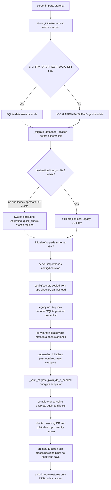

# Legacy data migration test plan

## Scope and baseline

- Repository: `Martin-soaring-dev/bili-fav-organizer`.
- Stable baseline: `v0.208`, commit `b39d7af30a8a365e1e491d848a70474036ec3113`.
- Candidate under test: current branch source at the commit recorded in the report.
- Historical schema source: `v0.208:store.py`, blob `f9380f5421769620dfdac162db712ca94fb9910b`.
- Runtime: Python unittest, with real SQLite initialization from each source version.

The tag and blob are checked at fixture generation. The v0.208 and current `store.py` blob hashes are currently equal, and both declare SQLite schema version 7. The historical tag predates `vault.py` and Electron Neo; those current behaviors are tested against the data produced by the old store, and cannot be claimed as historical v0.208 behavior.

## Verified migration path

### Implemented behavior

- SQLite schema migrations are recorded in `schema_migrations`; current and v0.208 schemas are at version 7 with matching `store.py` source.
- `_migrate_database_location()` copies only when the destination database does not exist. It uses SQLite's backup API, `quick_check`, a temporary sibling file and atomic replace. The project-local source is preserved.
- Fresh initialization backs up supported project-local JSON data before the SQLite importer processes it.
- `BILI_FAV_ORGANIZER_DATA_DIR` changes the SQLite `DATA_DIR` only. The server's config, secrets, vault metadata, app lock and device-secret files remain under `%LOCALAPPDATA%\BiliFavOrganizer`.
- Electron Neo computes the same default per-user root from `LOCALAPPDATA`; Electron's own `userData` is a `shell` child folder.
- Legacy settings are copied lazily by `load_config()`. Old `api_key`/`cookie_string` fields are moved into `secrets.json`, and provider bootstrap can then copy the API key into SQLite.
- Vault onboarding wraps a DEK with password and recovery code, and writes an encrypted database snapshot. Password and recovery unwrap are implemented.
- Electron requests graceful Python shutdown by closing the child stdin pipe and waits before killing the process tree.

### Not implemented or not established by code

- There is no v0.208-to-current SQL schema migration because `store.py` is byte-identical and the schema version is unchanged.
- Encrypted-only database restoration is not reliably reachable at ordinary startup: importing `store.py` initializes/creates the plaintext destination before unlock calls `_vault_restore_db_if_needed()`.
- There is no demonstrated final encrypted snapshot on ordinary application quit. The Electron quit handler stops the backend but does not call the vault save endpoint.
- Windows Hello/DPAPI requires Windows APIs and user interaction; it is not treated as verified by source inspection or unit tests.
- Electron's single-instance lock scopes to Electron Neo processes. The audited code does not establish a single cross-shell lock shared with the traditional Python/PyInstaller launcher.
- SQLite provider `api_key` fields remain in the active database; the database remains plaintext while it exists.

## Synthesized datasets

`seed_v0208.py` imports historical `store.py`; it does not hand-create the database schema. It freezes `time.strftime()` inside the fixture subprocess so historical row timestamps and core-data SHA-256 values are stable. All credentials are invalid placeholders. Fixture generation has no network access or real account data. `legacy-edge` copies a committed WAL snapshot while the historical writer is open, then lets the old process exit.

## Test matrix

Preconditions, actions and expected outcomes are documented in each test method docstring. Results and actual outcomes are in `legacy-migration-report.md`.

| ID | Expected evidence |
| --- | --- |
| MIG-001 | Empty v0.208 database imports with v7 schema and zero business rows. |
| MIG-002 | 10 folders, 500 videos and 1,000 memberships survive. |
| MIG-003 | WAL marker, duplicate resource references and interrupted scan state survive. |
| MIG-004 | `integrity_check=ok`, no `foreign_key_check` rows. |
| MIG-005 | Folder/video keys and many-to-many memberships remain consistent. |
| MIG-006 | Profiles, analyses, plans, scan state and application history remain. |
| MIG-007 | Invalid synthetic Cookie/API keys remain readable in their migrated destinations. |
| MIG-008 | Re-import is idempotent and leaves source available. |
| MIG-009 | Onboarding snapshot decrypts to logically identical data; locked state does not expose plaintext working files. |
| MIG-010 | Encrypted-only restart and unlock restore the same canonical data. |
| MIG-011 | Wrong password is rejected and vault stays locked. |
| MIG-012 | Recovery code unlocks and restores equivalent data. |
| MIG-013 | Full-file ciphertext corruption is rejected without creating a blank replacement DB. |
| MIG-014 | Injected SQLite copy and encrypted-write interruptions preserve source and permit retry; duplicate initialization must not replace the DEK. |
| MIG-015 | Traditional and Neo default path construction points to the same per-user directory; installed-shell execution is separately tracked. |
| MIG-016 | Plain safety backup can restore logical data and v0.208 reader can load the migrated schema. |
| MIG-017 | Fresh profile creates an independent empty current database. |
| MIG-018 | A second instance starts while a first holds a SQLite write transaction; after contention clears, retry and verify logical rows and integrity. |

## Fault and safety boundaries

All destructive actions are limited to `TemporaryDirectory` paths created for a single test. Controlled exceptions stand in for disk-full/termination. No tests inspect, create, or delete `%LOCALAPPDATA%\BiliFavOrganizer` from the host profile; no real credentials are read. Corrupt-database byte flips are performed only on a temporary fixture copy. A full-disk system condition is not induced; the write exception is its controlled substitute.

The test runner copies the source tree to a temporary checkout before importing any application code. It excludes `.git`, local credential directories, build outputs, and checked-in `tests/.test-data`. The full runner command is `python tools/run_isolated_tests.py`.

## Manual Windows acceptance checklist

Record each item `PASS`, `FAIL`, or `NOT_RUN` and include the Windows build/app version. Do not enter a real Bilibili account into synthetic test builds.

- [ ] Install and start traditional PyInstaller/Inno Setup build with isolated `%LOCALAPPDATA%`.
- [ ] Install and start Electron Neo build with the same isolated root; verify it reads the same logical baseline.
- [ ] Set/unlock application password and confirm lock state after restart.
- [ ] Exercise Windows Hello binding, lock and unlock with a disposable Windows test profile.
- [ ] Close Neo and confirm the Python child exits; inspect shell log and process list.
- [ ] Attempt concurrent legacy and Neo launches against the same test root; verify write exclusion or document actual behavior.
- [ ] Confirm no test files were written outside the isolated profile.

No checkbox may be marked passed from static source inspection alone.

### Observed on 2026-10-11

- Traditional PyInstaller/Inno Setup installation: `NOT_RUN`. The frozen PyInstaller backend built successfully as part of the Neo package, but the Inno Setup installer itself was not built or installed.
- Electron Neo unpacked startup: backend start and graceful shutdown `PASS` in an isolated profile. The existing UI smoke has 5 failing visual/version assertions; see `legacy-migration-report.md`.
- Traditional and Neo reading the same migrated fixture: `NOT_RUN`; the source path contract passes, but no traditional installed shell was available for this end-to-end comparison.
- Password-based restore from encrypted-only storage: `FAIL` in MIG-010. Recovery-code restore: `FAIL` in MIG-012.
- DPAPI helper round-trip unit coverage: `PASS` in the existing Windows unit suite. Windows Hello enrollment and real interactive unlock: `NOT_RUN`.
- Cross-shell simultaneous launch: `NOT_RUN`. MIG-018 only verifies controlled SQLite writer contention and retry; it does not prove cross-shell exclusion.
- Test databases and GUI profile were confined to temporary directories under the repository. No host user data profile was used.
